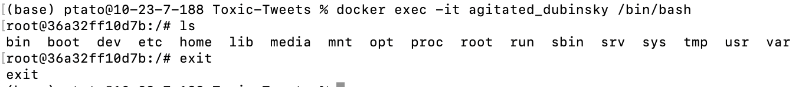

# CS-UY 4613 Project: Toxic Tweets

Instructions followed for Docker installation:  
(Note: I already had Docker installed beforehand, so these are the steps that I likely took when installing the first time)
> Followed Docker instructions for installation on Mac: [Install Docker Desktop for Mac](https://docs.docker.com/desktop/install/mac-install/) (Installed interactively)
  

> Ran the following command in terminal:  
    `$ softwareupdate --install-rosetta`
---
Docker Terminal:  
