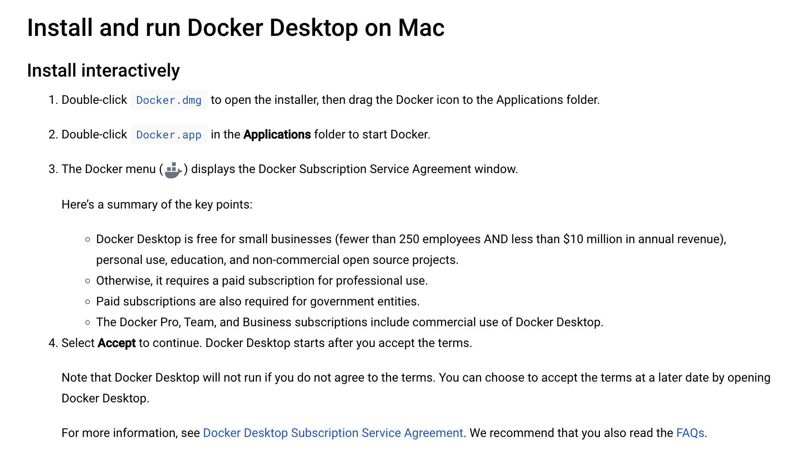

# CS-UY 4613 Project: Toxic Tweets

## Milestone 1: Docker Setup
Instructions followed for Docker installation: <br>
(Note: I already had Docker installed beforehand, so these are the steps that I likely took when installing the first time)
> Followed Docker instructions for installation on Mac: [Install Docker Desktop for Mac](https://docs.docker.com/desktop/install/mac-install/) (Installed interactively)
 <br>

> Ran the following command in terminal: <br>
    `$ softwareupdate --install-rosetta`
---
Docker Terminal: <br>


## Milestone 2: Sentiment Analysis App

Hugging face link: https://huggingface.co/spaces/Ptato/Sentiment-Analysis

## Milestone 3: Finetuned Toxicity Detection Model

Hugging face link: https://huggingface.co/spaces/Ptato/Sentiment-Analysis (Same as MS2) <br>
Note: To run app.py locally, unzip `test.csv.zip` first.

## Milestone 4: Documentation + Demo
The app is hosted on both [HuggingFace](https://huggingface.co/spaces/Ptato/Sentiment-Analysis) and a [Google Sites](https://sites.google.com/view/toxic-tweets/home). <br>
Check out ```app_demo.mp4``` for a quick demo on using the app!

### Training the Model

#### 1. Loading the data
